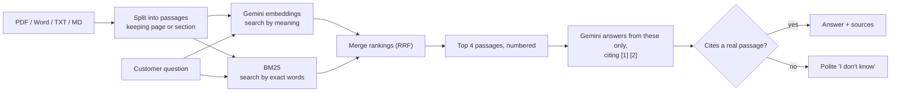

# DocAnswer: a customer-help chatbot that answers only from your documents

Upload your returns policy, FAQ and product guides. Customers get an instant answer **with the page it came from**, and an honest "I don't know" instead of a made-up one.

**Live demo:** _link coming soon_  
**Built by:** Bharti Shrivastava, AI automation engineer. [Hire me on Contra](https://contra.com/bharti_shrivastava_zu3hypce) to build one for your business.

---

## The problem it solves

Small businesses answer the same questions every day: *Can I return this? When will it arrive? Do you ship abroad?* A generic chatbot will happily guess, and a wrong refund policy costs money and trust.

DocAnswer answers **only** from the business's own documents, shows the source of every answer so anyone can check it, and refuses politely when the documents don't cover the question.

## Try it

The demo uses the policies of **Saffron & Thread**, a *fictional* handloom shop in Jaipur made up for this project: a returns policy, a shipping guide, a product-care guide (PDFs) and an FAQ (Word). You can download them from the app to check every answer yourself.

Questions to try:

| Ask | What you should see |
|---|---|
| Can I get my money back on a Final Sale item? | Exchange only, within 7 days, with the policy page cited |
| What size is SNT-BD-114? | 108 x 108 inches, from the product-code table in the FAQ |
| Do you ship to the USA, and who pays customs? | Yes, via DHL; customs paid by the customer |
| Do you sell wooden furniture? | A polite refusal: it isn't in the documents |

You can also upload your own PDF, Word, TXT or Markdown files in the sidebar.

## Results

The same 30 questions (26 answerable from the documents, 4 deliberately not) were run against a typical first-attempt setup and against this one. Every question records the file and page where the answer lives, so scoring is automatic and repeatable: `python eval/run_eval.py`.

<!-- RESULTS:START -->
_Run `python eval/run_eval.py` with a Gemini key to fill in this table._
<!-- RESULTS:END -->

## Why the answers can be trusted

- **Every answer cites its source.** The model must tag facts with [1], [2]. The code checks those numbers against the passages it was actually given and removes any it made up.
- **No source, no answer.** If an answer has no valid citation it is never shown; the customer gets a polite "please contact the team" instead.
- **Exact codes and prices are found.** Meaning-based search alone often misses things like `SNT-BD-114` or `₹149`, so a keyword search (BM25) runs alongside it and the two rankings are merged (Reciprocal Rank Fusion).
- **Passages keep their place.** Documents are split at sentence boundaries, never across pages or sections, and each passage is labelled with its document title and page before it is indexed.
- **Built for the free tier.** Embeddings are cached on disk (re-runs cost no API calls), rate-limit errors are retried with backoff, and the public demo caps questions per visit.

## How it works



Built with Python, **LangChain** (prompt template piped into the model), **Google Gemini** (`gemini-3.5-flash-lite` for answers, `gemini-embedding-001` for search), **Streamlit** for the interface and **pytest** for the tests.

## Run it on your computer

You need Python 3.10 or newer and a free Gemini API key from [Google AI Studio](https://aistudio.google.com/apikey).

```bash
git clone <this repository's URL>
cd rag-docs-chatbot
python -m venv .venv
# Windows: .venv\Scripts\activate     macOS/Linux: source .venv/bin/activate
pip install -r requirements.txt
cp .env.example .env        # Windows: copy .env.example .env   then paste your key into .env
python scripts/check_setup.py
streamlit run app.py
```

Without a key the app still runs in an **offline demo mode** that copies the best-matching sentence instead of calling Gemini, so you can look around first.

Tests and evaluation:

```bash
pip install -r requirements-dev.txt
pytest                                  # 37 tests, no key or internet needed
python eval/run_eval.py                 # baseline vs optimised, writes eval/results.md
python eval/run_eval.py --retrieval-only  # search quality only, fewer API calls
```

## Project structure

```
app.py                  Streamlit chat interface
docanswer/
  loaders.py            PDF (page numbers), Word (sections and tables), TXT/MD (headings)
  chunking.py           sentence-aware chunks with overlap; fixed-size baseline
  bm25.py               keyword search
  vector_index.py       embedding search + on-disk embedding cache
  hybrid.py             Reciprocal Rank Fusion
  prompting.py          grounded prompt, citation checks, refusal
  providers.py          Gemini via LangChain, retries, offline stand-ins
  engine.py             ties it together: build -> retrieve -> answer
  evaluation.py         deterministic scoring, no LLM-as-judge
eval/questions.jsonl    30 labelled questions
eval/run_eval.py        baseline vs optimised comparison
sample_docs/            the fictional shop's documents
scripts/                setup check, sample-document generator
tests/                  unit and end-to-end tests
```

## Limitations

- Scanned PDFs (photos of pages) contain no text and need OCR first.
- The evaluation covers 30 questions on one small set of documents. It is good for comparing setups, not a guarantee for every business.
- PDF tables are read as plain text; Word tables keep their rows.
- Embeddings are kept in memory, which suits a few dozen documents. Thousands of documents would need a vector database such as Chroma or pgvector.
- Gemini's free tier has daily limits, so the public demo allows 15 questions per visit.

## Want this for your business?

I set up document chatbots like this for shops, clinics, coaching institutes and agencies, connected to your own documents and your website. [Message me on Contra](https://contra.com/bharti_shrivastava_zu3hypce).

---

MIT licensed. Saffron & Thread and all its policies are fictional and exist only for this demo.
